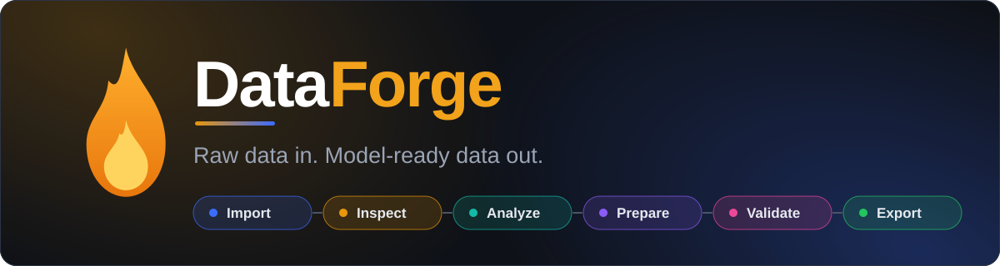
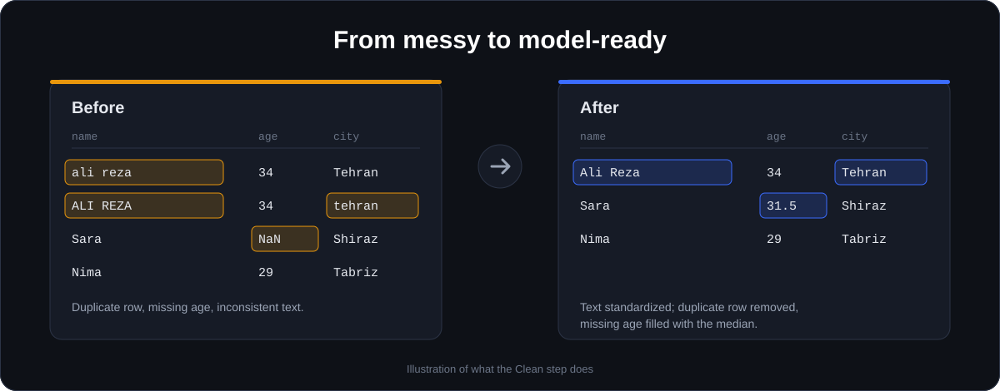

<div align="center">



<br>

<p>
Prepare datasets for machine learning with leakage-aware preprocessing.<br>
Inspect your data, evaluate preparation options, apply transformations, and export prepared datasets, a reusable pipeline and a report.
</p>

<a href="https://dataforge-tool.streamlit.app/">
  
</a>

<br><br>

[](https://github.com/MahdiKordian/DataForge/releases/tag/v2.0.1)
[](LICENSE)
[](https://github.com/MahdiKordian/DataForge/actions/workflows/tests.yml)
[](https://www.python.org)
[](https://streamlit.io)
[](https://github.com/MahdiKordian/DataForge/commits/main)
[](https://github.com/MahdiKordian/DataForge/stargazers)

[Why DataForge](#why-dataforge) · [Features](#features) · [Quick start](#quick-start) · [Use it from Python](#use-it-from-python) · [Documentation](#documentation) · [FAQ](#faq) · [Feedback](#feedback-and-support) · [License](#license)

</div>

---

## Table of contents

- [About](#about)
- [Why DataForge](#why-dataforge)
- [Workflow](#workflow)
- [Features](#features)
- [Quick start](#quick-start)
- [Use it from Python](#use-it-from-python)
- [Supported inputs and outputs](#supported-inputs-and-outputs)
- [Sample datasets](#sample-datasets)
- [How it works](#how-it-works)
- [Security and privacy](#security-and-privacy)
- [Testing and benchmarks](#testing-and-benchmarks)
- [Project structure](#project-structure)
- [Tech stack](#tech-stack)
- [Documentation](#documentation)
- [FAQ](#faq)
- [Roadmap](#roadmap)
- [Feedback and support](#feedback-and-support)
- [Changelog](#changelog)
- [License](#license)
- [Acknowledgements](#acknowledgements)
- [Author](#author)

## About

Preparing a dataset for machine learning involves more than handling missing values. It requires assessing data quality, identifying unsuitable features, selecting appropriate transformations, and ensuring that validation and test data do not influence preprocessing.

DataForge brings these tasks into a guided workflow. It helps you inspect a dataset, evaluate preparation options, apply transformations, validate the results, and keep a record of each operation. The workflow produces prepared training, validation and test datasets, a reusable JSON pipeline, a generated Python script, and a report.

DataForge is designed for students, data analysts, and machine learning practitioners who need a transparent and repeatable approach to dataset preparation.

<p align="center">
  
</p>

## Why DataForge

| The usual notebook | DataForge |
|---|---|
| Statistics are computed on all rows, then the data is split. Test information leaks into training. | **The data is split before preprocessing is fitted.** Imputation statistics, category mappings, outlier thresholds and scaling parameters are learned from the training set, then reused for validation and test data. |
| A leaked column or a duplicated row inflates the test score and nobody notices. | A **Leakage Guard** flags identical rows across sets and features that copy the target. |
| Preparation lives in cells that were run in some order. | The pipeline is **rebuilt from the raw training set after every change**, so Undo is exact and the order you clicked never matters. |
| "Which scaler, which imputation?" is decided by habit. | The **Advisor** examines the loaded dataset, identifies issues and explains available options. The **Lab** compares preparation choices with cross-validation on the training set only. |
| Applying the same steps to new data means copying code and hoping. | One **pipeline file** and a generated **Python script** reproduce the work. New files are checked against a **data contract** first. |
| A zip code is treated as a number, an ID as a feature. | **Variable types** are inferred with a confidence and a reason. You confirm or override them. |

## Workflow

**Import, Inspect, Analyze, Prepare, Validate, Export.** A progress bar at the top of the pages shows where you are, and you can move between pages freely.

| Stage | Pages | What you do |
|---|---|---|
| **Import** | Home, Dataset | Upload a file, paste a table, load from a link, pick a sample or type a small table. Choose the target column. |
| **Inspect** | Dashboard, Variable types, Advisor | Read the readiness score and the issue list. Confirm what each column is. Read the Advisor's findings and decide. |
| **Analyze** | Insights, Analysis, Compare | Statistics that explain their own limits, relationships, missing-data patterns, target analysis, and a comparison of two versions of the data. |
| **Prepare** | Prepare, Lab | Split first, then Clean, Transform, Encode and Scale, with a preview before every step. Use the Lab when you are unsure which method is better. |
| **Validate** | Contract | Write the rules a valid file must follow and check new files against them. |
| **Export** | Export, Pipeline, Report, Projects | Download the data, the saved pipeline, the Python script and the report. Save the whole piece of work and reopen it later. |

## Features

### Load safely

- **Flexible loading.** Upload a file, paste from a spreadsheet, load from a URL, or type a small table. Separators, encodings and Excel sheets are detected automatically or set by hand.
- **Checked on the way in.** The file type must match its content, size is limited, spreadsheet zip bombs are refused, and links are fetched only if they point to public addresses. See [Security and privacy](#security-and-privacy).
- **Personal-data warning.** Columns that look like emails, phone numbers, card numbers, IBANs or IP addresses are flagged, and their example values are hidden in reports.

### Understand the data

- **Health dashboard.** A readiness score that is a weighted checklist, not a prediction of model quality, plus a list of detected issues ranked by severity. Each issue points to the step that fixes it.
- **Variable types.** Number, category, ordinal, ID, date or text, with a confidence and a reason for each guess. Your choices are used by every later step.
- **Advisor.** Finds problems (numbers stored as text, missing data, duplicate rows, constant columns, ID-like columns, numbers that may be categories, outliers, skew, class imbalance) and lists the options with pros, cons and when each applies. For missing values it shows what every option would do to the data. It never picks a winner.
- **Insights.** Univariate statistics, relationships, missing-data analysis, data-quality checks and Target intelligence. Associations measured on too few rows are marked unreliable.
- **Target intelligence.** Analysis that follows the kind of problem: classification, regression, time series or unsupervised.
- **Analysis views.** Overview, distributions, missing values, correlations (Pearson, Spearman, Kendall, Cramér's V, correlation ratio, VIF), outliers (IQR, Z-score, modified Z-score), categoricals, target, PCA, and before vs after.
- **Compare.** Two versions of a dataset side by side, with drift measured by PSI and the KS test.

### Prepare without leakage

Split comes first. After that the steps run in a fixed, safe order.

| Step | What you can do |
|------|-----------------|
| **Split** | Remove rows with a missing target, then create train, validation and test sets using your chosen ratios and seed. Optionally stratify the split and oversample or undersample the **training set only** for imbalanced classes. |
| **Clean** | Trim whitespace, change text case, convert numbers stored as text, remove duplicate rows, drop constant and mostly-empty columns, and handle missing values with the median, mean, most common value, zero or "Unknown", or by dropping rows with missing values in selected columns. Overrides are available per column. Infinite values are treated as missing. |
| **Transform** | Clip outliers at the 1st and 99th percentile or at IQR bounds, remove outlier rows, reduce skew with a log or square-root transform, drop highly correlated or unwanted columns. |
| **Encode** | One-hot or ordinal encoding for columns with few categories, frequency or ordinal encoding (or dropping) for high-cardinality columns, date columns split into year, month, day and weekday, text targets turned into numeric classes. |
| **Scale** | Standard (z-score), Min-max (0 to 1) or Robust (median and IQR) scaling on the columns you choose. |

Every step has **Preview** (nothing is changed), **Run**, and page-level **Undo last step** and **Reset** controls. Rows with a missing target are excluded before the split. After splitting, preparation-time row-removal operations, including duplicate removal, outlier-row removal and the "Drop rows" missing-value strategy, affect the training set only. Validation, test and new data otherwise retain their rows, keeping predictions aligned with the input records.

### Decide with evidence

- **Lab.** Runs several preparation choices through the same cross-validation on the training set and reports the mean and spread for each. A difference smaller than the fold-to-fold spread is reported as "no clear difference". The test set is never used.

### Validate

- **Leakage Guard.** Identical rows across train, validation and test are reported as certain problems. Features that copy the target are reported as suspicious.
- **Data contract.** Rules per column (type, allowed values, range, missing allowed). Infer a contract from a good file, edit it, and validate any new file against it. Failing rows are listed.

### Export and reproduce

- **Pipeline file.** One JSON file with the settings and everything learned from the training set. Run it on a new file with *Apply* (reuse the learned values) or *Re-fit* (learn again). The file is checked against the pipeline's input contract first.
- **Python script.** A generated script that reproduces the preparation from the same settings. It contains only your settings as literals.
- **Projects.** Save the whole piece of work (settings, decisions, optionally the data) in a local folder and reopen it later. The saved steps are re-run and reproduce the same result.
- **Reports at three levels.** *Executive summary* (a few quantified points), *Analytical* (statistics and relationships) and *Technical* (every step, setting, leakage result and version), as HTML (light, dark or automatic theme) or Markdown.
- **Full audit trail.** Each change is logged and can be downloaded as CSV, JSON or text. The log records step names, counts and settings, never cell values.

### Work with larger data

The **Performance** page shows the dataset size tier and the measures available to keep analysis responsive, including sampling and memory reduction through smaller data types. DataForge also provides utilities for selected large-file tasks: `profile_in_chunks` reads a CSV in chunks and reports row counts, missing-value counts and numeric statistics; categorical summaries are capped and may be partial. The optional DuckDB helper summarizes local CSV or Parquet files without loading them into pandas, while the Polars helper reads a limited CSV preview. The main preparation workflow still loads the dataset into memory; these utilities do not make the full pipeline out-of-core.

## Quick start

### Use it online

Click the **Open the Live Demo** button at the top. Nothing to install, and you can start from a built-in sample dataset.

> The demo runs on Streamlit Community Cloud and goes to sleep when idle. If you see a sleeping notice, click the wake-up button and wait a few seconds.
>
> On the hosted demo your data is processed on Streamlit's servers. For private or sensitive data, run DataForge on your own computer.

### Run it locally

You need **Python 3.10 or newer**.

```bash
# 1. Get the code
git clone https://github.com/MahdiKordian/DataForge.git
cd DataForge

# 2. Create an isolated environment (recommended)
python -m venv .venv
```

Activate the environment.

macOS and Linux:

```bash
source .venv/bin/activate
```

Windows PowerShell:

```powershell
.\.venv\Scripts\Activate.ps1
```

Install the dependencies and launch the app:

```bash
pip install -r requirements.txt
streamlit run app.py
```

Streamlit prints a local address, usually <http://localhost:8501>.

Optional settings, as environment variables:

| Variable | Meaning | Default |
|---|---|---|
| `DATAFORGE_MAX_MB` | Largest accepted file | `200` |
| `DATAFORGE_HOME` | Folder where projects are saved (`<folder>/projects`) | `~/.dataforge` |

### Run it for your team

You can run DataForge on a computer or server of your own organization, for use by your own people. The MIT License allows this and more (see [License](#license)).

DataForge has no login and no per-user separation. Read [Security and privacy](#security-and-privacy) before you put it on a network that others can reach.

## Use it from Python

The core, published as `dataforge-engine` (import name `dataforge_engine`), does not depend on Streamlit, so everything the app does can be scripted.

```python
import pandas as pd
from dataforge_engine import build_pipeline, make_spec, dumps, loads, apply_saved, to_script, split_frame
from dataforge_engine.defaults import default_cfg

# Load the dataset and choose the target column.
df = pd.read_csv("customers.csv")
target = "churn"

# 1. Split before fitting preprocessing steps.
split = {"test_pct": 20, "val_pct": 10, "seed": 42, "stratify": True}
train_raw, val_raw, test_raw, notes = split_frame(df, target, **split)

# 2. Fit the pipeline on training data, then transform the other sets.
cfg = default_cfg(target_is_class=True)
pipe = build_pipeline(cfg, target)
train_ready = pipe.fit_transform(train_raw)
val_ready = pipe.transform(val_raw) if val_raw is not None else None
test_ready = pipe.transform(test_raw)

# 3. Save the fitted pipeline and a script that reproduces the preparation.
spec = make_spec(pipe, cfg, split, train_raw, name="customers")
with open("pipeline.json", "w", encoding="utf-8") as file:
    file.write(dumps(spec))
with open("prepare.py", "w", encoding="utf-8") as file:
    file.write(to_script(spec, "customers.csv"))

# 4. Apply the saved pipeline to new data.
with open("pipeline.json", encoding="utf-8") as file:
    saved_spec = loads(file.read())
new_ready, warnings = apply_saved(saved_spec, pd.read_csv("new_customers.csv"))
```

The generated `prepare.py` imports `dataforge_engine`, so it runs anywhere the package is installed.

## Supported inputs and outputs

| | Formats and options |
|---|---------------------|
| **Input files** | CSV, TSV, TXT, Excel (`.xlsx`, `.xls`), JSON, Parquet |
| **Other inputs** | Pasted text, URL, manually typed table, built-in samples |
| **Parsing** | Auto-detected or manual separator (comma, semicolon, tab, pipe), encoding fallback (UTF-8, UTF-8 with BOM, CP1256, Latin-1) |
| **Prepared data** | CSV, Excel, Parquet, JSON, with an optional row index. CSV can be written as UTF-8 with BOM so Excel shows non-Latin text such as Persian correctly |
| **Reproducibility** | Pipeline (`.json`), generated Python script, project folder |
| **Step log** | CSV, JSON, plain text |
| **Report** | HTML and Markdown at three levels (Executive summary, Analytical, Technical), with the sections you choose |

## Sample datasets

Three real datasets ship in `sample_data/` and are offered on the home page, each with the usual problems so every step has something to do.

| Dataset | Task | Target | Challenges |
|---------|------|--------|------------|
| Ames Housing | Regression | `SalePrice` | Many columns, missing values, skewed prices |
| Telco Customer Churn | Classification | `Churn` | Class imbalance, numbers stored as text, an ID column |
| Palmer Penguins | Classification | `species` | Three classes, missing values, mixed types |

The files are `Ames_Housing.csv`, `Telco_Customer_Churn.csv` and `Palmer_Penguins.csv`. If one is missing from `sample_data/`, its card on the home page is disabled and shows which file to add. The Dataset page also offers three small generated practice sets: customer churn, house prices and student scores.

## How it works

DataForge is a multi-page Streamlit app on top of a core that knows nothing about Streamlit.

```
load -> [Types] -> split -> fit on TRAIN -> transform VALIDATION and TEST -> check leakage -> save pipeline
```

- **Variable types are suggested before the split.** The Types page uses the loaded dataset to suggest column roles; you can confirm or override those suggestions. These are type classifications, not fitted imputation, encoding or scaling statistics.
- **Every fitted preparation step is a transformer** with `fit(train)` and `transform(df)`. Data-dependent values are learned from training data, and `transform` applies them without modifying its input.
- **The UI keeps only the settings of each step.** After every change the whole pipeline is rebuilt from the raw training set, so Undo is exact and the final result does not depend on the order of the clicks.
- **Rows with a missing target are excluded before splitting.** After the split, row-removing preparation steps (duplicate removal, missing-value row dropping and outlier removal) and class balancing affect the training set only.
- **The Lab and the Advisor have different roles.** The Lab evaluates preparation choices using training data only. The Advisor analyzes the loaded dataset to identify issues and explain options; it does not fit the final preprocessing pipeline.
- **Pipelines are plain JSON.** Step types are looked up in a fixed list and unexpected fields are refused, so loading a pipeline file never runs code. There is no pickle anywhere.
- **Reports and exports come from the same log and snapshots**, so they match what you actually did.

See [docs/ARCHITECTURE.md](docs/ARCHITECTURE.md) for the module-by-module description and how to add a new step.

## Security and privacy

DataForge is meant to run on your own computer or in a private deployment.

- **Uploads** are limited to known types, checked against their content, size-limited and screened for zip bombs.
- **Links** accept only `http` and `https`, standard ports, and addresses that are public. Loopback, private, link-local, shared (100.64.0.0/10) and cloud-metadata addresses are refused, and every redirect is checked again.
- **No code from files.** No pickle, JSON pipelines only, and the generated script contains only your settings as literals.
- **Projects** use safe names and stay inside the project folder. Writes are staged in a sibling directory; existing projects are backed up and can be restored if replacement is interrupted. Stored data is checked against a fingerprint on opening.
- **Local data processing.** When you run DataForge locally, uploaded and pasted dataset contents are processed by the local application; they are not sent to a separate DataForge data-processing service. The interface loads fonts from Google Fonts, so your browser contacts Google to retrieve those font files. Loading data from a URL also makes an outbound request from the machine running DataForge. Projects that you save locally are written to the configured project folder.
- **Hosted demo and access control.** The public demo runs on Streamlit Community Cloud, where uploaded data is processed on Streamlit servers. Do not upload private or sensitive datasets to the public demo. There is no login or per-user separation, so anyone who can access a self-hosted instance can access its saved projects. Put authentication in front of the app before exposing it to a network. The personal-data scan is a warning mechanism, not a guarantee.

The full list, including what is not protected, is in [docs/SECURITY.md](docs/SECURITY.md).

## Testing and benchmarks

The project includes more than 100 automated tests covering transformers, splitting, leakage checks, saved pipelines, data contracts, security checks, project persistence, sample datasets and release-file consistency.

```bash
python -m pip install -r requirements.txt -r requirements-dev.txt
python -m pytest
```

A GitHub Actions workflow runs the tests on every push, on Python 3.10 and 3.12. Tests that require optional packages or sample files are skipped when those requirements are not available.

The benchmark suite checks the numbers against known answers (15 of 15 checks passed in the last run), measures speed and memory as the data grows, and compares DataForge with other profiling tools. On the benchmark machine (one CPU), a complete analysis of a 5,000 by 20 table took about one second, against 5.7 to 21.9 seconds for ydata-profiling and Sweetviz. The tools produce different outputs, so read this as time to a usable analysis, not as a like-for-like race, and expect different numbers on your machine. Details and the method are in [docs/BENCHMARK.md](docs/BENCHMARK.md).

```bash
python benchmarks/run_benchmark.py --quick    # smaller sizes; rewrites benchmarks/results/ and docs/BENCHMARK.md
```

## Project structure

```
DataForge/
├── app.py              Entry point: page config, navigation, sidebar
├── core.py             Shared UI helpers: state, navigation, file readers, samples
├── dataforge_engine/   The core (pandas, NumPy, SciPy; no Streamlit)
│   ├── transformers.py   Preparation steps with fit and transform
│   ├── pipeline.py       Ordered pipeline, schema check, save and restore
│   ├── splitting.py      Random and stratified split, class balancing
│   ├── leakage.py        Leakage Guard
│   ├── readiness.py      Weighted, explainable readiness checklist
│   ├── types.py          Variable type inference
│   ├── advisor.py        Problems and options, never a verdict
│   ├── analysis.py       Statistics and relationships
│   ├── target.py         Target intelligence
│   ├── diff.py           Compare two versions, drift
│   ├── contract.py       Data contract
│   ├── persist.py        Pipeline file and generated script
│   ├── lab.py            Cross-validated comparison of choices
│   ├── reporting.py      Report content for three levels
│   ├── scale.py          Sampling, memory reduction, chunked profile
│   ├── security.py       Upload checks, safe download, personal-data scan
│   ├── projects.py       Save and reopen work
│   └── benchmark.py      Synthetic data, speed and correctness checks
├── pages/              Streamlit pages (Home, Dataset, Dashboard, Variable types,
│                       Advisor, Insights, Prepare, Lab, Analysis, Compare, Contract,
│                       Pipeline, Export, Projects, Performance, Report, About)
├── tests/              Automated tests
├── .github/            Issue templates and the test workflow
├── .streamlit/         Streamlit settings (upload limit, usage statistics off)
├── benchmarks/         Benchmark scripts and results
├── sample_data/        Ames Housing, Telco Customer Churn, Palmer Penguins
├── docs/               Guides and README images
├── requirements.txt    Python dependencies
├── requirements-dev.txt    Development and benchmark dependencies
├── README.md           This file
├── CHANGELOG.md        What changed in each version
├── LICENSE             MIT License
├── NOTICE              Third-party attributions
├── .gitattributes
└── .gitignore
```

## Tech stack

| Library | Used for |
|---------|----------|
| [Streamlit](https://streamlit.io) | Web interface and multi-page navigation |
| [pandas](https://pandas.pydata.org) | Data loading and transformation |
| [NumPy](https://numpy.org) | Numerical work, splitting and sampling |
| [SciPy](https://scipy.org) | Statistics behind correlations and tests |
| [scikit-learn](https://scikit-learn.org) | Models for the Lab |
| [Altair](https://altair-viz.github.io) | Interactive charts |
| [openpyxl](https://openpyxl.readthedocs.io) | Reading and writing `.xlsx` files |
| [xlrd](https://xlrd.readthedocs.io) | Reading legacy `.xls` files |
| [PyArrow](https://arrow.apache.org) | Reading and writing Parquet files |
| [Requests](https://requests.readthedocs.io) | Safe download from a link |
| [Polars](https://pola.rs) and [DuckDB](https://duckdb.org) | Optional, for files that do not fit in memory |

## Documentation

| Guide | What it covers |
|---|---|
| [User guide](docs/USER_GUIDE.md) | The path through the app, why Split comes first, Advisor and Lab, saving and repeating your work, how to read the numbers |
| [Architecture](docs/ARCHITECTURE.md) | The core module by module, the data flow, how to add a step |
| [Security and privacy](docs/SECURITY.md) | What is protected, what is not, and the settings |
| [Benchmark](docs/BENCHMARK.md) | Correctness, speed, memory and comparison with other tools |

## FAQ

<details>
<summary><b>Why is Split the first step in Prepare?</b></summary>
<br>
Every value a step learns, such as a median, a category list or a scaling range, must come from the training set only. If it is computed on all rows, information from the test set leaks into training and the test score looks better than it is. DataForge splits first and learns on the training set.
</details>

<details>
<summary><b>What happens to rows with a missing target?</b></summary>
<br>
When you select a target column, rows with a missing value in that column are removed before the train, validation and test sets are created. This prevents records without a known target from entering a supervised split.
</details>

<details>
<summary><b>Why were duplicate rows removed from my training set but not from the test set?</b></summary>
<br>
After splitting, preparation-time row-removal operations act on the training set only. Validation, test and new data retain their rows, so predictions stay aligned with the records you sent in.
</details>

<details>
<summary><b>The readiness score is 100. Is my model going to be good?</b></summary>
<br>
No. The score is a checklist of preparation problems, not a prediction of accuracy. Likewise, an association between two columns is a statistical link, never proof of cause.
</details>

<details>
<summary><b>The "Use this sample" button is disabled.</b></summary>
<br>
The dataset file is not in the <code>sample_data/</code> folder. The card shows which file to add. You can also upload your own file.
</details>

<details>
<summary><b>My CSV shows broken characters in Excel.</b></summary>
<br>
On the Export page, keep the Excel-friendly option (UTF-8 with BOM) turned on. It makes Excel read non-Latin text such as Persian correctly.
</details>

<details>
<summary><b>Why can't I stratify or balance my split?</b></summary>
<br>
Both need a classification target. Choose a target column on the Dashboard first, and make sure it has a limited number of classes.
</details>

<details>
<summary><b>The split reports an empty train or test set.</b></summary>
<br>
Use smaller test and validation percentages, or load a dataset with more rows.
</details>

<details>
<summary><b>Excel export says my data is too large.</b></summary>
<br>
Excel holds at most 1,048,575 rows per sheet. Export to CSV or Parquet instead.
</details>

<details>
<summary><b>Is my data uploaded or stored anywhere?</b></summary>
<br>
When you run DataForge locally, uploaded and pasted dataset contents are processed by the local application and are not sent to a separate DataForge data-processing service. The interface loads fonts from Google Fonts, so your browser contacts Google to retrieve those files. Loading data from a URL also makes an outbound request from the machine running the app. Projects that you save are written to the configured project folder. The public demo runs on Streamlit Community Cloud, where uploaded data is processed on Streamlit's servers; do not upload private or sensitive data there. Streamlit usage statistics are disabled in <code>.streamlit/config.toml</code>.
</details>

<details>
<summary><b>How large a file can I upload?</b></summary>
<br>
DataForge accepts up to 200 MB by default; change it with <code>DATAFORGE_MAX_MB</code>. Streamlit has its own upload limit, <code>server.maxUploadSize</code>, which is set to 200 in <code>.streamlit/config.toml</code>. Files are read into memory, so for very large data see the Performance page.
</details>

<details>
<summary><b>Can I use the prepared data with scikit-learn?</b></summary>
<br>
Yes. The prepared train, validation and test sets are ordinary tables that you can download and feed to any library, and the saved pipeline can prepare new data the same way. Exporting the pipeline as a scikit-learn object is on the roadmap.
</details>

<details>
<summary><b>Can I use DataForge for client or commercial work?</b></summary>
<br>
Yes. The MIT License permits commercial use, modification and redistribution of DataForge, subject to its license terms. It does not change the rights or license terms that apply to third-party datasets and dependencies. See <a href="#license">License</a> and <code>NOTICE</code>.
</details>

<details>
<summary><b>Can I fork it, change it or host my own version?</b></summary>
<br>
Yes. The MIT License allows it, as long as you keep the copyright notice and the license text in your copy. Pull requests are welcome; see [CONTRIBUTING.md](CONTRIBUTING.md).
</details>

## Roadmap

Ideas for future versions. Open an issue if one of these matters to you.

- [ ] Export the pipeline as a scikit-learn pipeline
- [ ] More encoders, such as target encoding
- [ ] Docker image for one-command deployment
- [ ] Optional login for shared deployments

## Feedback and support

Found a bug, or have an idea? [Open an issue](https://github.com/MahdiKordian/DataForge/issues/new/choose). The templates ask for what is needed to reproduce a problem: the version shown in the sidebar, the page and step, and what you expected.

- **Do not post personal or confidential data** in a public issue. Describe the shape of your data or use a small made-up example.
- **Security problems** go through GitHub's private reporting, not a public issue. See [docs/SECURITY.md](docs/SECURITY.md).
- **Code contributions** are welcome as pull requests. Read [CONTRIBUTING.md](CONTRIBUTING.md) first. By sending one, you agree that it is released under the MIT License, like the rest of the project. For bigger ideas, open an issue first.

## Changelog

What changed in each version is in [CHANGELOG.md](CHANGELOG.md).

## License

DataForge is released under the [MIT License](LICENSE), copyright 2026 Mahdi Kordian. You can use, copy, modify, merge, publish, distribute, sublicense and sell it, as long as you keep the copyright notice and the license text. It comes without warranty.

Versions up to 1.x were published under the Apache License 2.0, and copies of those versions stay under it. Third-party libraries and the sample datasets keep their own licenses, listed in [NOTICE](NOTICE).

## Acknowledgements

- **Ames Housing** by Dean De Cock.
- **Palmer Penguins** by Dr. Kristen Gorman and the Palmer Station LTER, packaged by Allison Horst and Alison Hill.
- **Telco Customer Churn**, an IBM sample dataset.
- The open-source libraries listed in the tech stack above.

Please check each dataset's original terms before redistributing it.

## Author

**Mahdi Kordian**, AI Engineer working on machine learning, deep learning, generative AI and LLMs.

<p align="center">
  <a href="https://github.com/MahdiKordian"></a>
  <a href="https://www.linkedin.com/in/mahdikordian/"></a>
  <a href="https://t.me/MahdiKordian/"></a>
  <a href="https://x.com/MahdiKordian/"></a>
</p>

<div align="center">

If DataForge saves you time, consider giving it a star ⭐

</div>
